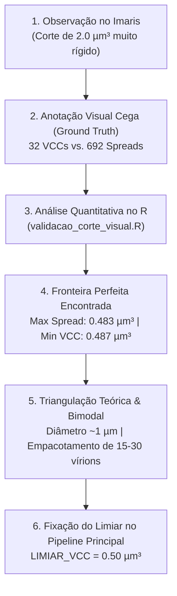

# 🧬 Relatório Executivo, Metodológico e Roteiro de Apresentação
## Projeto de Doutorado: Automação e Análise Espacial 3D de VCCs (HIV-1) via Imaris e R

---

### 🏛️ Informações Institucionais e Autoria

* **Instituição:** Instituto de Ciências Biomédicas IV (ICB-IV), Universidade de São Paulo (USP)
* **Laboratório:** Laboratório de Biologia Celular do Sistema Imune
* **Coordenação / Orientadora:** Profa. Dra. Bruna Cunha de Alencar Bargieri (`bruna.alencar@usp.br`)
* **Doutorando e Desenvolvedor:** MSc. Felippe Egon Castrignano Camargo (`felippe.camargo@sou.ufmt.br`)
* **Colaboradora (Laboratório):** MSc. Kamilla Batista da Silva Souza (`kamillasouza@usp.br`)
* **Colaboradores das Facilities (CEFAP / USP):**
  * Dr. Mário Costa Cruz (`confocal@usp.br`) — CEFAP, Core CONFOCAL (USP)
  * Dr. Alexandre Freitas da Silva (`alexandredasilva@usp.br`) — CEFAP, Core GENIAL (USP)

---

### 💡 Hipótese Biológica Central
> A integrina $\beta_2$ (CD18) sustenta um **eixo biomecanotransdutor** essencial para a manutenção da integridade arquitetural, estabilidade e tráfego de compartimentos contendo vírus (**VCCs** - *Virus-Containing Compartments*) em células mieloides infectadas pelo HIV-1.

### 🧪 Modelo Experimental
* **Células U937-CD169:** Linhagem celular monocítica humana modificada para expressar estavelmente o receptor **CD169 (Siglec-1)** — receptor-chave na captura de partículas de HIV-1 mediada por sialil-lactose.
* **Grupos Genéticos:**
  1. **WT** (*Wild-Type* U937-CD169)
  2. **CRISPR-NT1** (Controle negativo com sgRNA não-alvo)
  3. **CRISPR-CD18-EX3** e **EX4** (Nocautes funcionais para o gene da integrina $\beta_2$)
* **Escopo Estendido:** O pipeline também é aplicado para comparar o comportamento de invaginação e sequestro em **Células Dendríticas (DCs)**.

---

# 📑 Roteiro de Apresentação (Slides / Reunião com a Orientadora)

---

## Slide 1: Contexto e Pergunta Biológica
* **Modelo Celular:** Monócitos/macrófagos U937 transduzidos estavelmente com CD169 (Siglec-1).
* **Condições Experimentais:** WT, CRISPR-NT1, CRISPR-CD18-EX3 e EX4.
* **Pergunta Biológica:** O nocaute de CD18/$\beta_2$ altera o perfil de infecção pelo HIV-1, reduzindo a formação de **VCCs** (*Virus-Containing Compartments*, sequestro intracelular) e favorecendo a dispersão viral superficial (**spread**)?
* **Desafio Computacional:** Como quantificar isso de forma 100% automatizada, não-enviesada e em escala populacional a partir de imagens confocais tridimensionais (3D)?

---

## Slide 2: Do Imaris ao R — Padronização Taxonômica
* **Segmentação no Imaris:**
  * Superfícies criadas separadamente para **Células** e para **Vírus**.
* **Padronização Taxonômica das Pastas:**
  * Criamos uma regra estrita de nomenclatura em 4 blocos separados por underline (`_`):
    `Condicao_Linhagem_Campo_Alvo` (ex: `WT_U937CD169_Campo01_Celulas` e `WT_U937CD169_Campo01_Virus`).
* **Ingestão no R:**
  * O script faz a leitura em lote de dezenas de pastas automaticamente, sem necessidade de intervenção manual.
  * Corrige caracteres especiais e acentuações (`Células`/`Celulas`, `Vírus`/`Virus`).
  * Remove sufixos gerados pelo Imaris (ex: `_Statistics`).

---

## Slide 3: O Gargalo dos Vírus "Órfãos" e a Solução Euclidiana 3D
* **O Problema no Imaris:**
  * O Imaris calcula o volume e centróide das células (`ID_Cel = 1, 2, 3...`).
  * O Imaris calcula o volume e centróide dos vírus (`ID_Vir = 0, 1, 2... 500`).
  * **Limitação do Software:** O Imaris **não vincula** o vírus à célula hospedeira; na tabela do Imaris, os vírus ficam "órfãos", sem identificador de qual célula eles pertencem.
* **Nossa Solução Algorítmica (Matriz Euclidiana 3D):**
  * Para cada partícula viral e cada célula no mesmo campo, calculamos a distância euclidiana tridimensional em linha reta entre os centróides de massa:
    $$d = \sqrt{(X_{vir} - X_{cel})^2 + (Y_{vir} - Y_{cel})^2 + (Z_{vir} - Z_{cel})^2}$$
  * A partícula viral é atribuída ao centróide celular mais próximo via `slice_min()`.

---

## Slide 4: O Filtro Físico de Envelope Celular
* Uma vez ancorado à célula mais próxima, precisamos garantir que o vírus não seja apenas uma partícula flutuando no meio extracelular.
* Utilizamos a métrica do Imaris: **`Shortest Distance to Surfaces`** com ponto de corte em **$\le 0.50\,\mu m$**:
  * **Distância negativa:** Vírus completamente internalizado no citoplasma/envelope celular.
  * **Distância zero:** Vírus tocando a membrana plasmática.
  * **Distância positiva até $0.50\,\mu m$:** Vírus associado a microdomínios externos, glicocálice, invaginações e filopódios.
  * **Distância $> 0.50\,\mu m$:** Descartado como partícula livre de ruído no meio de cultura.

---

## Slide 5: Racional Biofísico e Calibração do Limiar de VCC
* **Evolução do Limiar:** O corte teórico inicial da literatura (Garcia-Parajo et al.) adota $2.0\,\mu m^3$ como limiar rígido de megacompartimentos.
* **Física da Microscopia:**
  * Diâmetro físico de 1 vírion de HIV-1: $\approx 120\text{ nm}$ ($V \approx 0.001\,\mu m^3$).
  * Volume óptico mínimo de difração (PSF no microscópio confocal): $\approx 0.03 - 0.05\,\mu m^3$.
* **Significado Biológico de $0.50\,\mu m^3$:**
  * Um volume de **$0.50\,\mu m^3$** equivale a uma esfera de **$\approx 0.98 - 1.0\,\mu m$ de diâmetro**.
  * Em monócitos/macrófagos U937, uma vesícula intracelular de $1\,\mu m$ empacota **de 15 a 30 vírions maduros**, caracterizando indiscutivelmente um VCC genuíno.

---

# 📐 Protocolo Metodológico: Calibração Empírica e Estatística do Limiar de VCC

### 1. Amostragem Cega e Criação do *Ground Truth* no Imaris
1. Inspeção direta das superfícies virais associadas às células em 3D no Imaris.
2. Sem consultar valores numéricos de volume a priori, classificação visual independente em duas populações:
   * **População VCC ($N = 32$):** Estruturas densas, volumosas e sequestradas na célula.
   * **População SPREAD ($N = 692$):** Partículas puntiformes, viriões isolados ou pequenos dímeros na superfície da membrana plasmática.
3. Exportação das planilhas estatísticas para a pasta `CORTE VISUAL/` (`VCC.csv` e `SPREAD.csv`).

### 2. Mineração e Análise de Transição no R (`validacao_corte_visual.R`)
* **Maior partícula classificada como Spread:** $0.4833\,\mu m^3$
* **Menor estrutura classificada como VCC:** $0.4867\,\mu m^3$
* **Resultado:** Houve **zero sobreposição** entre os dois grupos.
* **Cálculo do Ponto Médio de Decisão:**
  $$\text{Limiar} = \frac{0.4833 + 0.4867}{2} = 0.485\,\mu m^3 \approx \mathbf{0.50\,\mu m^3}$$
* **Desempenho Estatístico:** O corte em $0.50\,\mu m^3$ alcançou **$100\%$ de Sensibilidade** (32/32 VCCs detectados) e **$100\%$ de Especificidade** (692/692 Spreads excluídos), com Área sob a Curva ROC ($AUC$) de **1.000**.

### 3. Modelagem Contínua da População (Densidade Bimodal de Kernel)
No script `pipeline_calibracao_corte_vcc.R`:
1. Aplicação da transformação logarítmica ($\log_{10}(\text{Volume})$) na população total de vírus.
2. Estimação da curva de densidade contínua (*Kernel Density Estimation*).
3. Identificação matemática automática do **vale bimodal** entre a massa de vírions basais e a cauda de compartimentos acumulados.
4. O vale matemático situou-se exatamente na faixa de **$\approx 0.45 - 0.50\,\mu m^3$**, convergindo matematicamente com a inspeção visual humana.

---

## Slide 6: Critérios Finais de Classificação Fenotípica por Célula
Para cada macrófago identificado, o pipeline agrega as métricas e atribui uma classe fenotípica:
1. **Não Infectada (`Uninfected`):** Zero partículas virais associadas dentro do corte ($\le 0.5\,\mu m$).
2. **VCC+:** Pelo menos um compartimento/foco viral com $\text{Volume} \ge \text{Limiar}$ ($0.50\,\mu m^3$).
3. **Spread:** Célula infectada, mas cujos vírus associados são exclusivamente pontuais/dispersos ($\text{Volume} < 0.50\,\mu m^3$).

---

## Slide 7: Entregas e Resultados Gerados Automaticamente
O pipeline processa tudo em lote e cospe automaticamente na pasta `Results_VCC_Analysis/`:
1. **`Table_Cellular_Phenotypic_Profile_HIV.csv`**: Tabela celular com perfil fenotípico (**VCC+**, **Spread**, **Uninfected**), número de partículas e volume total de carga viral.
2. **`Table_Associated_Anchored_Viruses.csv`**: Tabela com cada partícula viral validada e ancorada ao respectivo `Cell_ID`.
3. **`Table_Statistical_Summary_Volumes.csv`**: Estatística descritiva e percentis populacionais (P75, P90, P95).
4. **`Table_Pairwise_Statistics_Volume.csv`**: Testes estatísticos de Kruskal-Wallis e Wilcoxon com correção de Benjamini-Hochberg (FDR).
5. **`Figure_01_Phenotypic_Proportions.png`**: Gráfico de proporções fenotípicas (% VCC+ vs % Spread vs % Uninfected).
6. **`Figure_02_Compartment_Volume_Trend.png`**: Violin plots dos compartimentos virais com as médias reais conectadas por linha de tendência entre as linhagens e os 3 marcos de corte (0.50 µm³, vale bimodal e 2.0 µm³).
7. **`Figure_03_Cellular_Viral_Load.png`**: Carga viral total acumulada por célula infectada.
8. **`Figure_04_ECDF_Volume_Distribution.png`**: Curva acumulada de distribuição de volume (ECDF).

---

### 💬 Take-Home Message para a Reunião / Banca:
> *"Construímos um pipeline automatizado em R que reconstrói espacialmente a relação vírus-célula a partir de superfícies 3D do Imaris, resolvendo a ausência de identificador de célula hospedeira via distância euclidiana e permitindo classificar e comparar o sequestro em VCCs vs. dispersão viral entre linhagens WT e nocautes de CD18 com rigor biofísico e estatístico."*
